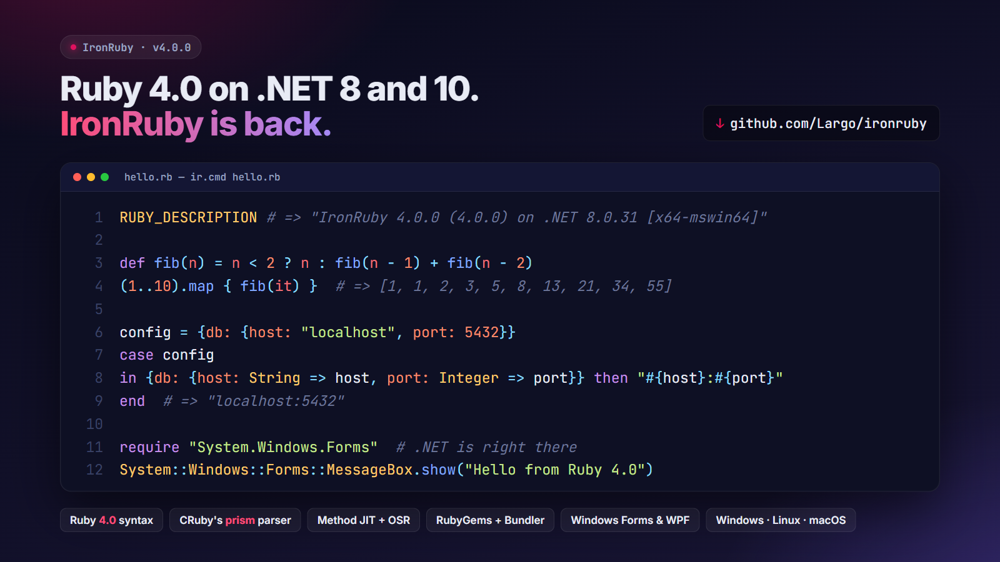
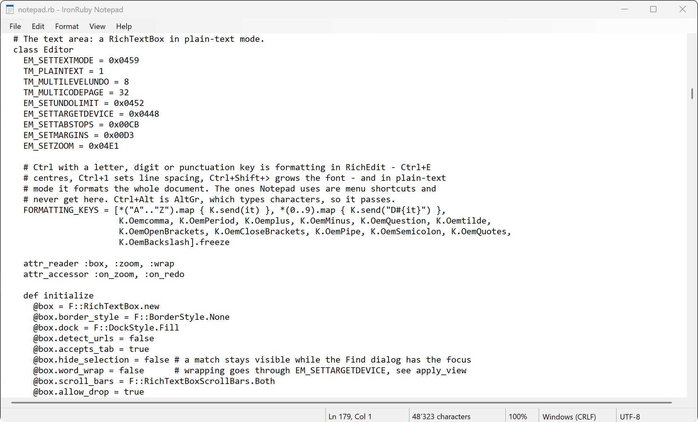

# IronRuby, modernized

[](https://github.com/Largo/ironruby/actions/workflows/ci.yml)
[](https://github.com/Largo/ironruby/releases/latest)



A fork of [IronRuby](https://github.com/IronLanguages/ironruby) — Ruby on the .NET CLR —
brought back to life: it **builds and runs on .NET 8 and 10**, and it parses Ruby with
**[prism](https://github.com/ruby/prism), CRuby's own parser**, instead of the hand-ported
Ruby 1.9 grammar it shipped with in 2011.

**IronRuby 4.0 is the first stable release since 1.1.3 in 2011**, and 4.0.2 is its latest.
The downloads are self-contained: unpack one and run it, there is no .NET to install.

**The compatibility target is Ruby 4.0.** IronRuby aims to run what CRuby 4.0 runs, with
the same results: the language, the core classes and the standard library are checked
against [ruby/spec](#status) and against CRuby 4.0 itself, and where IronRuby's behaviour
differs from CRuby 4.0's, that is a bug in IronRuby. Ruby 3.x behaviour that 4.0 changed
(`Set` as a core class, `Hash#inspect`, frozen string literals, the error messages) is
not kept.

| | Download | |
|---|---|---|
| **Windows** x64 | [ironruby-4.0.2-win-x64.zip](https://github.com/Largo/ironruby/releases/download/v4.0.2/ironruby-4.0.2-win-x64.zip) | with Windows Forms, WPF and the Notepad sample |
| **Linux** x64 | [ironruby-4.0.2-linux-x64.tar.gz](https://github.com/Largo/ironruby/releases/download/v4.0.2/ironruby-4.0.2-linux-x64.tar.gz) | |
| **macOS** arm64 | [ironruby-4.0.2-osx-arm64.tar.gz](https://github.com/Largo/ironruby/releases/download/v4.0.2/ironruby-4.0.2-osx-arm64.tar.gz) | built in CI, not tested there |

[SHA256SUMS](https://github.com/Largo/ironruby/releases/download/v4.0.2/SHA256SUMS) ·
[release notes](https://github.com/Largo/ironruby/releases/tag/v4.0.2) ·
[all releases](https://github.com/Largo/ironruby/releases) · [getting started](#binary-releases)

[](https://github.com/Largo/ironruby/releases/download/v4.0.0/ironruby-4-launch.mp4)

▶ **[Watch the whole launch video](https://github.com/Largo/ironruby/releases/download/v4.0.0/ironruby-4-launch.mp4)** (55 s, MP4)

## Highlights

- **Ruby 4.0, parsed by prism**: pattern matching, endless methods, `it`, keyword
  arguments, `...` forwarding — the syntax CRuby 4.0 accepts, read by CRuby's own parser.
- **[ruby/spec](#status) at CRuby 4.0.6**: `spec/language` (2,934 examples) and
  `spec/library` (6,398) pass with **0 failures**; `spec/core` has 21 of 23,136, 20 of them
  `ObjectSpace.each_object`.
- **[A method JIT and OSR](#performance)**, on by default: integer and float loops, `fib`
  and `mandelbrot` run in **0.27–0.74×** CRuby's time. Over all 50 benchmarks the geomean
  is 3.25×; calls, strings and arrays are where the work is.
- **irb 1.16 + reline**, **RubyGems 4.0.16 and Bundler** over real TLS, and Ruby 4.0's
  standard library and bundled gems.
- **[Rails 8.1 boots](#rails)** and serves requests through Rack (with nokogiri stubbed).
- **.NET is right there**: `require "System.Windows.Forms"`, and Windows Forms and WPF load
  from the Windows download. [`irubyc`](#packaging-an-application-irubyc) turns a Ruby
  program into one executable, or into a plugin DLL for a .NET host.



*[`Samples/Notepad`](Samples/Notepad/notepad.rb) is Windows Notepad in 1,365 lines of Ruby:
encodings and line endings that survive a save byte for byte, find and replace, go to,
zoom, printing, the status bar. Here it edits its own source. It ships in the Windows
download (`Samples\Notepad\notepad.cmd`), and [its test](Samples/Notepad/test_notepad.rb)
drives it in CI with nobody at the keyboard.*

## A first look

```console
$ ./irb.sh
irb(main):001> RUBY_DESCRIPTION
=> "IronRuby 4.0.2 (4.0.0) on .NET 8.0.31 [x86_64-linux]"
irb(main):002> def fib(n) = n < 2 ? n : fib(n - 1) + fib(n - 2)
=> :fib
irb(main):003> (1..10).map { fib(_1) }
=> [1, 1, 2, 3, 5, 8, 13, 21, 34, 55]
irb(main):004> require "io/console"; IO.console.winsize
=> [44, 80]
irb(main):005> Point = Struct.new(:x, :y)
=> Point
irb(main):006> case Point.new(3, 4)
irb(main):007*   in [Integer => x, Integer => y]
irb(main):008*     Math.hypot(x, y)
irb(main):009*   end
=> 5.0
irb(main):010> 1 / 0
(irb):10:in 'Integer#/': Attempted to divide by zero. (ZeroDivisionError)
        from (irb):10:in '<main>'
```

That is **irb 1.16.0 and reline 0.6.3**, the same ones CRuby 4.0 ships — with syntax
highlighting, auto-indent, Tab completion, history and `ls`/`show_source` — running on
IronRuby. `io/console` is a C extension in CRuby, so IronRuby implements it over termios.

Scripts run the same way, and gems install with real TLS:

```console
$ ./ironruby script.rb       # prism front end, vendored stdlib, JIT and OSR on
$ ./igem.sh install rack     # or: ./ironruby -S gem install rack
$ ./ironruby -S bundle install
```

The interpreter is `ironruby` (`ironruby.cmd` on Windows), as JRuby's is `jruby`: it is
RbConfig's `ruby_install_name`, so the binstubs Bundler and Rails write start
`#!/usr/bin/env ironruby` - a `#!` line with "ruby" in it, which Ruby runs as Ruby. (Those
RubyGems writes for an installed gem name the launcher by its path instead, `#!<root>/ironruby`,
so they only work where that path still does.) `ir.sh` and `ir.cmd` are its short name, the
one IronRuby has used since 1.x, and run the same thing.
`igem` / `iirb` / `irubyc` keep the i-prefix so they can sit on `PATH` beside CRuby's `gem`
and `irb`, as JRuby's `jgem`, `jirb` and `jrubyc` do. The unprefixed `gem`, `irb`, `bundle`,
`bundler` and `irubyc` live in `Src/StdLib/bin` and are what `ironruby -S <name>` finds.
On Windows the build also has `ironrubyw.exe` next to `ir.exe`, as CRuby has `rubyw.exe` and
JRuby `jrubyw.exe`: the same interpreter as a Windows GUI program, which gets no console
window - for Windows Forms and WPF programs; `Samples\Notepad\notepad.cmd` starts it.

```ruby
# all of this runs today
case config
in {db: {host: String => host, port: Integer => port}} then "#{host}:#{port}"
in {db: {socket:}} then socket
end

def connect(host:, port: 5432, **opts) = Client.new(host, port, **opts)

users&.filter_map { it.name if it.active? }
```

## Calling .NET

The interop IronRuby always had still works: CLR namespaces are modules, `List[String]`
instantiates a generic, `Method#of` a generic method, `include ILivingCreature` implements an
interface, a Ruby subclass overrides virtual members, out parameters come back with the result.
On top of that, .NET APIs now take the Ruby you would write today:

```ruby
System::Console.WriteLine "hi"     # platform assemblies load on demand, no load_assembly

list = System::Collections::Generic::List[Integer].new([3, 1, 4])   # an Array for IEnumerable<int>
list.Sort { |a, b| b <=> a }       # a block goes to the trailing delegate parameter
list.ForEach { |x| break if x < 3 } # break ends the CLR call, as it does a Ruby one

using System::Linq                  # extension methods for the rest of the file, as C#'s `using`
list.where { it > 1 }.order_by { -it }.to_a      # => [4, 3]
list.select { it * 2 }.to_a        # => [8, 6, 2], LINQ's Select ahead of Enumerable#select
[3, 1].select { it > 1 }           # => [3], an Array keeps Array#select and gets no LINQ

Widget.new(title: "Hi", width: 300) # keywords bind parameters by name, or set properties
Greeter.greet("Ann", greeting: "Hello", times: 2)

func = Funcs.Doubler               # a Func<int, int>
[1, 2].map(&func)                  # delegates are callable like lambdas: call, to_proc, >>, curry
ok, n = System::Int32.TryParse("42")

case Point.new(1, 2)               # a C# record
in {x: 1, y:} then y               # members by their Ruby or CLR name
end
min, max = Stats.MinMax(values)    # a ValueTuple destructures like an Array
System::Threading::Tasks::Task.Run { 6 * 7 }.value   # => 42
System::Runtime::CompilerServices::RuntimeHelpers.GetSubArray(array, 1..-2)  # a Ruby range for System.Range

class Doctor < Human                # a CLR class without a parameterless constructor
  def initialize(name)
    super("Dr. #{name}")            # super runs the CLR base constructor
  end
end
System::Math::PI                    # const and static readonly fields are constants
command.Parameters.AddWithValue("$name", "Ann")   # a Ruby String for an Object parameter is a System.String
```

`using` a CLR namespace works like C#'s `using` directive and like a refinement: its extension
methods are visible from that point to the end of the file, class body or eval string, and
nowhere else. `using System::Linq::Enumerable` brings in one static class's (C#'s `using static`).
Inside it, calls resolve as they did under the older `using_clr_extensions`, which activates a
namespace for the whole runtime and is deprecated: an extension method of a CLR type comes ahead
of the Ruby methods the type picks up from `Enumerable` (`list.select` is LINQ's), a CLR method
group gets them as more overloads (`list.count(pred)`, the instance member winning an exact tie),
and a Ruby object such as an Array, whose ancestors don't include `IEnumerable[T]`, gets none.
Moving from one to the other means changing that one line.

Also: a `Method` converts to a delegate, `IComparable<T>` types are `Comparable`,
`IAsyncEnumerable<T>` is `Enumerable`, C# 8 default interface methods are callable and run for
Ruby implementations, `include System::IComparable` works although the name is also a generic,
and `Method#parameters` names a CLR method's parameters. See
[`Src/IronRuby.Tests/Runtime/ClrBinderTests.cs`](Src/IronRuby.Tests/Runtime/ClrBinderTests.cs),
[`ClrProtocolTests.cs`](Src/IronRuby.Tests/Runtime/ClrProtocolTests.cs) and
[`ClrRuntimeInteropTests.cs`](Src/IronRuby.Tests/Runtime/ClrRuntimeInteropTests.cs) for the
exact behaviour.

## Version numbers

IronRuby's version follows the Ruby version it implements: **IronRuby 4.0 is Ruby 4.0**,
and it becomes 4.1 when it moves to Ruby 4.1. The last number counts IronRuby's own
releases for that Ruby version (4.0.0, 4.0.1, ...) and is not CRuby's patch level; the
release notes say which CRuby release the specs were checked against. The last release of
the original project was 1.1.3, for Ruby 1.9.2, in 2011.

`IRONRUBY_VERSION` is the full version (`4.0.2`, or `4.0.0-preview1` for a pre-release),
`RUBY_ENGINE_VERSION` the same without the pre-release suffix, and `RUBY_VERSION` the Ruby
version (`4.0.0`).

## What changed

| | before | after |
|---|---|---|
| Runtime | .NET Framework 4 | **.NET 8** (Linux, macOS, Windows) |
| Build | legacy msbuild, 12 configurations | SDK-style `dotnet build` |
| Parser | hand-ported 1.9 grammar (~13k lines) | **prism** — the parser CRuby uses |
| `RUBY_VERSION` | `1.9.2` | `4.0.0` |
| Big integers | `Microsoft.Scripting.Math` | `System.Numerics` |
| Integer | Int32, then BigInteger | Int32 → **Int64** → BigInteger |
| Execution | DLR interpreter, then IL | + a **method JIT and OSR** that specialize on observed types |
| REPL | irb from 2011 | **irb 1.16.0 + reline**, on a termios `io/console` |
| Gems | RubyGems 1.3.7 (2010) | **RubyGems 4.0.16 + Bundler**, installing over real TLS; `gem install rails` resolves without compiling C |

## The prism front end

Ruby source is parsed by `libprism.so` through P/Invoke, decoded from prism's binary
serialization by a **generated** C# loader, and mapped onto IronRuby's existing AST — so the
whole AstGenerator/DLR compilation pipeline works unchanged. It is the only parser: the
hand-ported 1.9 grammar and its lexer have been removed. This is the same architecture
JRuby uses for its Java loader:

```
source ──▶ libprism ──▶ binary AST ──▶ PrismLoader ──▶ PrismAstBridge ──▶ IronRuby AST ──▶ DLR
                     (pm_serialize_parse)  (generated)     (lowering)
```

`Src/Prism/generate.rb` reads prism's `config.yml` and emits 152 typed node classes plus the
deserializer, so upgrading prism is: rebuild the native library, re-run the generator, fix
what the compiler flags. The loader version-checks the serialization format at runtime.

Modern syntax with no equivalent in the 1.9-era AST is **lowered** rather than rejected:

- **pattern matching** → `===` / `deconstruct` / `deconstruct_keys` tests with capture bindings
  (guards, find patterns, `**nil`, pins, alternations, `=>` and `in`)
- **keyword arguments** → trailing optional hash + a prologue (missing-keyword `ArgumentError`,
  defaults, `**rest`)
- **safe navigation** → nil-guarded temporary
- **`it` / `_1`** → explicit block parameters, **`...`** → `*rest, &block` forwarding

See [`Src/Prism/README.md`](Src/Prism/README.md) for the details and the known gaps.

## Status

Measured with [ruby/spec](https://github.com/ruby/spec) at CRuby 4.0.6, `Util/parallel-sweep.sh`:

| suite | examples | failing |
|---|---|---|
| `spec/language` | 2934 | **0** |
| `spec/command_line` | 175 | **0** |
| `spec/security` | 34 | **0** |
| `spec/library` | 6398 | **0** |
| `spec/core` | 23136 | **21** — 20 of them `ObjectSpace.each_object`, which needs `-X:ObjectSpace` |
| IronRuby's own C# test suite | ~1470 | 19 known |

CRuby 4.0.6 is the oracle: where a spec and IronRuby disagree, the behaviour is checked
against `ruby` and IronRuby is changed, not the spec. The aim is Ruby 4.0 compatibility
rather than compatibility with any earlier Ruby: a difference from CRuby 4.0 that a
program can observe is a bug worth a report, specs or not.

The same tree **runs on Windows**, where `spec/language` and `spec/security` are also at
zero; see [Windows](#windows) for how to build it and what is still missing there.

The **Ruby 4.0 standard library is vendored** in `Src/StdLib/ruby/4.0`; `Src/StdLib/ironruby`
holds what CRuby implements as C extensions, written in C# (`Src/Libraries`) or Ruby, and is
the only other library directory on the load path. A compatibility prelude
([`Src/StdLib/ironruby/ruby4.rb`](Src/StdLib/ironruby/ruby4.rb)) supplies what MRI provides
natively — `Process.clock_gettime`, `Random`, `ObjectSpace::WeakMap`, `ruby2_keywords`,
pattern-matching support classes and core methods from Ruby 2.x-4.x; `Rational` and `Complex`
are Ruby ports of CRuby 4.0's `rational.c` and `complex.c`, and `Pathname` is CRuby 4.0's own
`pathname_builtin.rb`. `Ripper` is implemented
on prism, the way CRuby 4.0 implements it, and `io/console` over termios, so the current
**irb** and **reline** run unmodified.

What is left is mostly what .NET cannot do: `fork`, a controlling TTY, `setproctitle`,
C-extension APIs (`fiddle`, `mkmf` compiling), and heap walking (`ObjectSpace.each_object`
is opt-in behind `-X:ObjectSpace`, as JRuby's is behind `-X+O`).

### Default gems

The libraries IronRuby implements in C# - `bigdecimal`, `json`, `psych`, `openssl`,
`zlib`, `stringio`, `strscan`, `digest`, `date`, `etc`, `fcntl`, `io/console`, `prism` -
are advertised to RubyGems as **default gems**, with gemspecs in
`Src/StdLib/ruby/gems/4.0.0/specifications/default` generated by
[`Util/gen-default-gemspecs.rb`](Util/gen-default-gemspecs.rb).  Without them the resolver
does not know the library is already there: `gem install activesupport` used to download
`bigdecimal`'s C sources and try to compile them.  This is what JRuby does for the same
reason.  The versions in the table are checked against the running interpreter's own
`VERSION` constants when the gemspecs are generated, so they cannot drift.

### Bundled gems

CRuby 4.0's pure-Ruby **bundled gems** - `rake`, `rexml`, `minitest`, `test-unit`, `csv`,
`logger`, `matrix`, `net-imap`/`-smtp`/`-pop`/`-ftp`, `drb`, `racc`, `ostruct` and the rest -
ship as real installed gems in IronRuby's own gem home, `Src/StdLib/ruby/gems/4.0.0`, at the
versions CRuby 4.0.6 bundles, so `require "rexml/document"` and `ir -S rake` work the same on
every machine, with or without a CRuby next to IronRuby.
[`Util/install-bundled-gems.rb`](Util/install-bundled-gems.rb) installs them from a CRuby
source tarball's `gems/*.gem` and lists the ones left out and why (the C extensions IronRuby
implements itself, and the ones that need `rbs`).  IronRuby never uses the gems of a CRuby
installed on the same machine: a gem it needs is installed for IronRuby, with `igem install`
or Bundler.

A C extension is never built: there is no `ruby.h` to compile against.  Such a gem is left alone -
its `.rb` files load, a real `require` of the `.so` raises `LoadError`, and the pure-Ruby
fallback most of them carry is used instead.

### Rails

A Rails 8.1 application boots and serves HTTP requests through Rack:

```
RAILS GET /hello       -> 200 "Hello world from Rails 8.1.3.1 on ironruby 4.0.0"
RAILS GET /hello/Iron  -> 200 "Hello IronRuby from Rails 8.1.3.1 on ironruby 4.0.0"
```

ActiveSupport, ActiveModel, ActionDispatch, ActionController, ActionView (ERB templates
through the real resolver), ActiveJob, ActiveRecord and railties all install and load.
Two things stop a *complete* Rails app, and neither is a Ruby-level bug:

- **nokogiri** is a C extension (libxml2 + gumbo) and a hard dependency of
  `rails-html-sanitizer` -> `loofah` -> `actionview`, and of `rails-dom-testing` ->
  `actionpack`.  Everything above was measured with a load-only stub in its place; the
  sanitize helpers, the dom assertions and the HTML error page need a real implementation.
- **ActiveRecord has no adapter**: `sqlite3`, `pg`, `mysql2` and `trilogy` are all native.

## Performance

Two compilers specialize on the types a program actually uses. Both are **on by default**
(`-X:NoJIT`, `-X:NoOSR` turn them off), and both fall back to the generic path rather than
guess:

- **Method JIT** — a hot method body is replaced by a copy with unboxed `int`/`long`/`double`
  locals, CLR arithmetic, no per-call scope, and direct calls for self-recursion. One integer
  compare of a global method-table version guards redefinition, override, singleton methods,
  `prepend`, `include` and `alias`; refinements switch it off; overflow and division by zero
  deopt to the generic body.
- **OSR** — a loop that has taken enough back edges is replaced *while it runs* by a
  type-specialized copy over the same locals tuple, so there is no state to materialize. This
  is what reaches a hot loop inside a block that is only ever entered once, which no
  invocation-counting JIT can see. If the types change, the copy is rebuilt.

`Util/bench/run.sh` (50 benchmarks, Release, ratio to CRuby 4.0.6 — lower is better):

| | ratio |
|---|---|
| `float_arith`, `cmp_branch`, `int_arith`, `mandelbrot`, `fib`, `while_loop` | **0.27 – 0.74** (faster than CRuby) |
| calls, ivars, string and array work | 2 – 4 |
| geomean over all 50 | **3.25** |
| `raise_rescue`, `fiber_switch` | 150+ (backtrace construction; a CLR thread per Fiber) |

Build with `-c Release` and run with `IR_CONFIG=Release ./ir.sh`: the optimized build is
~1.8x faster than the default Debug build across the whole suite. See
[`Util/bench/README.md`](Util/bench/README.md).

`IRONRUBY_STARTUP_TRACE=1` prints, when the process exits, where its startup went: milestones
since the process started, and for the Ruby files it loaded the time spent parsing them
(prism), transforming them to the DLR tree, compiling them for the interpreter and running
their own code, slowest files first.

## Packaging an application (`irubyc`)

`irubyc` is IronRuby's answer to JRuby's `jrubyc`: it turns a Ruby program into a .NET
application that runs without the source tree.

```console
$ ./irubyc.sh -t /tmp/out app.rb lib/
irubyc: wrote /tmp/out/app
irubyc: run it with /tmp/out/app/app
$ /tmp/out/app/app --some --args
```

It generates a C# host, compiles it with the .NET SDK, and embeds every `.rb` file in the
resulting assembly as a **managed resource**; a `PlatformAdaptationLayer` overlay serves
those resources to the runtime, so the main script, `require` and `load` read them out of
the assembly. No `.rb` file is written next to the executable. The output directory also
gets IronRuby's assemblies, `libprism` and a copy of the standard library (including
whatever `igem` has installed), so `require "json"` and `require "some_gem"` work.

**Be clear about what it does not do: `irubyc` does not emit IL for the Ruby code.** The
embedded sources are still parsed and compiled by IronRuby at startup, exactly as
`ir app.rb` would, so a compiled application starts no faster than the same script run
from a source tree — what you get is a single deployable directory, not AOT-compiled Ruby.
Real AOT exists as a prototype in [`Util/aot`](Util/aot/README.md): it ports .NET
Framework's expression-tree compiler onto `PersistedAssemblyBuilder` (.NET 10), so Ruby
compiles to a saved assembly that runs with no parsing at all, and it builds IronRuby under
NativeAOT. It is not wired into `irubyc` yet, and has not been run against ruby/spec.

Options, with jrubyc's names kept where they mean the same thing:

| | |
|---|---|
| `-t, --target DIR` | where to write the application directory (default `.`) |
| `-d, --dir BASEDIR` | base directory the embedded paths are relative to |
| `-p, --prefix PREFIX` | prefix prepended to every embedded path |
| `--main FILE` | which script to run (default: the first file given) |
| `-o, --output NAME` | name of the application |
| `--exe` / `--dll` | native launcher (default), or just `<name>.dll` for `dotnet <name>.dll` |
| `--self-contained [RID]` | bundle the .NET runtime too — runs with no .NET installed |
| `--single-file [RID]` | produce **one executable file** instead of a directory (combine with `--self-contained`) |
| `--library` | produce **one class library** (`<name>.dll`) that a .NET host loads as a plugin |
| `--cs FILE` | C# source compiled into the `--library` (repeatable) |
| `--reference DLL` | an assembly the host provides: compiled against, not bundled (repeatable) |
| `--framework TFM` | target framework (default: the one the running IronRuby was built for) |
| `--no-stdlib` | leave out the vendored Ruby 4.0 tree and the gems (30 MB → 19 MB) |
| `--keep`, `--verbose` | keep the generated C# project / narrate every step |

### One file (`--single-file`)

```console
$ ./irubyc.sh --single-file -t /tmp/out app.rb lib/
$ ls /tmp/out/app
app
$ ./irubyc.sh --single-file --self-contained -t /tmp/out app.rb lib/   # no .NET needed to run it
```

This uses the .NET SDK's own single-file bundler. Everything the directory layout has next
to the assembly — IronRuby's DLLs, the native `libprism` and sqlite libraries, and the
standard library — goes into the one file, and the first run extracts it to a per-app cache
(`~/.net/<app>/…`, or `$DOTNET_BUNDLE_EXTRACT_BASE_DIR`). Later runs reuse the cache. Because
the extracted layout is exactly the directory layout, nothing in IronRuby needs to know it
was bundled: `require`, `load_assembly`, `eval` and native libraries all behave the same.
On Linux, for the demo above: **32 MB** framework-dependent, **99 MB** self-contained. The
file is for the platform it was built on — the bundle carries that machine's native
libraries — so `irubyc` refuses a RID for another OS or CPU instead of producing a file that
cannot parse Ruby on its target.

Sizes, for a three-file demo app on Linux: **30 MB** framework-dependent (18 MB of that is
the standard library, 12 MB IronRuby, the DLR and `libprism`), **101 MB** with
`--self-contained`, which then runs on a box with no .NET at all. `irubyc` itself needs the
.NET SDK; the application it produces does not. It links whichever build of IronRuby is
running it, so `IR_CONFIG=Release ./irubyc.sh …` produces a Release-linked application.

Startup, best of seven on an idle Linux box, Debug build: `./ir.sh -e ''` 1.58 s, the demo
app from its source tree 1.96 s, the same app compiled 1.77 s — the small difference is the
shell wrapper and reading the sources from memory rather than the disk, not compiled Ruby.

The embedded tree behaves like a read-only directory at `<app>/src`: `require`,
`require_relative`, `load`, `File.read`, `Dir.glob` and `Dir.entries` all see it, because
those go through the DLR's `PlatformAdaptationLayer`, which is what the overlay replaces.
What does **not**: `File.exist?` and the rest of `FileTest` answer `false` for an embedded
file, because they stat the real file system directly rather than ask the platform layer;
`__FILE__` and `$0` name a path that has no directory behind it; and anything that shells
out to `ruby` or re-execs `$0` will not find an interpreter.

### One plugin DLL (`--library`)

```console
$ ./irubyc.sh --library -o Plugin -t /tmp/out --cs Plugin.cs \
      --reference Host.Api.dll plugin.rb
irubyc: wrote /tmp/out/Plugin/Plugin.dll
```

For a host that loads plugins — typically one that `Assembly.LoadFile`s every DLL in a
plugin directory — `--library` makes **one
class library** carrying IronRuby, the DLR, `libprism` and sqlite, the standard library and
the Ruby files. .NET has no single-file mode for a library, so it unpacks itself: IronRuby,
the natives and `Lib/` are one zip embedded as a resource, and a generated bootstrap extracts
it on first use and resolves IronRuby from there. The `--cs` files are compiled into the
DLL; they reach IronRuby through a generated `IronRuby.Embedded.RubyHost`:

```csharp
var engine = RubyHost.CreateEngine();          // stdlib, prelude and RubyGems booted, prism parser
var scope  = engine.CreateScope();
scope.SetVariable("plugin", this);
dynamic ruby = RubyHost.Run(engine, "plugin.rb", scope);   // an embedded file; returns its last value
```

`CreateEngine` makes the DLL's own assembly and every `--reference` visible to Ruby, so
`Host::Api::SomeType` resolves; `CreateEngine(runtime => ..., language => ...)`
adjusts the setups (`runtime.PrivateBinding = true` lets Ruby call protected CLR members, which
IronRuby otherwise allows only from a Ruby subclass). `RubyHost.RunMain` runs the main file,
`RubyHost.ExtractDirectory` says where the payload went.

- **First use extracts.** IronRuby needs a real `Assembly.Location` (for `Lib/` and RbConfig)
  and the natives have to be files to be loaded at all, so nothing runs from memory. The payload
  goes to `$IRUBYC_EXTRACT_BASE_DIR/<name>-<hash>/`, by default `<temp>/irubyc-<user>/` (created
  `0700`; a directory others can write to is refused). `<hash>` is the payload's SHA-256, so a
  rebuilt DLL never reuses a stale copy, and the build is byte-for-byte reproducible. Each
  process extracts into a private temporary directory and renames it into place, so concurrent
  first loads are safe — the losers use the winner's copy — and a copy with files missing is
  moved aside and extracted again. For a small demo plugin: about 250 ms to extract, 33 MB on disk.
- **Type-load order.** A plugin host calls `GetTypes()` on the DLL before any of its code runs,
  and IronRuby is not resolvable until the bootstrap has installed its resolvers. The resolvers
  are installed by a `[ModuleInitializer]`, which runs before the first method of the DLL (the
  host's constructor call), and everything that *derives* from IronRuby types lives in a second,
  generated assembly inside the payload. So the `--cs` code must not derive from or implement
  IronRuby/DLR types, nor hold them in struct fields; fields, locals, parameters and return
  types of IronRuby types are fine — the CLR resolves those only when a method using them is
  compiled.
- **Load contexts.** IronRuby is loaded into the plugin's own `AssemblyLoadContext`
  (`Assembly.LoadFile` gives every plugin one); that context's `Resolving` event is the hook that
  fires, `AppDomain.AssemblyResolve` is only a fallback. Two IronRuby plugins in one process each
  get their own IronRuby, and neither sees the other's.
- **Platform.** Like `--single-file`, the DLL carries the build machine's native libraries. The
  DLL itself would load anywhere, so it checks at run time and fails with a message naming the
  platform it was built for. Build on Windows for Windows.

For a small demo plugin:
9.3 MB with the standard library, 5.4 MB with `--no-stdlib`. The first run of the activity in a
process, extraction and booting the engine included, takes about 2.4 s (1.2 s with `--no-stdlib`,
which skips RubyGems); later runs of the activity take a few milliseconds.

## Platforms

Linux is the primary target and the one the numbers above are measured on. **Windows works**:
`ir.cmd` and `irb.cmd` run, and `spec/language` (2920 examples) and `spec/security` pass with
**0 failures**. `spec/core` and `spec/library` are rougher there — symlinks/chmod/umask in
`core/file`, fork and signals in `core/process`, and `IO.select`/`IO#wait` on pipes (which is
`poll(2)`, so `core/io` and the socket suites hang rather than fail). Win32OLE and
readline are not implemented on Windows; `IO.console` is nil, so irb falls back to its ANSI
input path. Windows Forms and WPF (`require "System.Windows.Forms"`, `"PresentationFramework"`)
come from the Windows Desktop runtime, which `ir` references whenever it is built for Windows
(`-p:IronRubyWindowsDesktop=false` leaves it out); on Linux and macOS they do not exist.
[`Samples/Notepad`](Samples/Notepad/notepad.rb) is Windows Notepad written that way, in Ruby
(`Samples\Notepad\notepad.cmd`); its test drives it with nobody at the keyboard and runs in CI.
macOS (arm64) is built by the release workflow but not tested in CI; pipes to child
processes, socket addresses and Puma were fixed there in 4.0.1 (#12, #13).

## Binary releases

[Releases](https://github.com/Largo/ironruby/releases) carry a ready-to-run IronRuby for
Linux x64, Windows x64 and macOS arm64 (not tested in CI); the [table at the top](#ironruby-modernized)
links the ones for 4.0.2. They are self-contained, so no .NET has to be installed. Unpack
one and run the launchers in it:

```console
$ tar xzf ironruby-4.0.2-linux-x64.tar.gz && cd ironruby-4.0.2-linux-x64
$ ./ironruby -e 'puts RUBY_DESCRIPTION'
$ ./irb.sh
$ ./igem.sh install rack
```

From 4.0.2 on, the archives have `ironruby` and `ironruby.cmd` (see above), and `ir.sh` /
`ir.cmd` keep working; 4.0.1 and earlier have only those.
On Windows, unzip it and use `ironruby.cmd`, `irb.cmd` and `igem.cmd`, or double-click
`Samples\Notepad\notepad.cmd`. From 4.0.3 on there is also an installer,
`ironruby-<version>-win-x64-setup.exe`, in the style of RubyInstaller: it installs the same
tree into `C:\IronRuby40-x64` (or a directory you choose), for you or for all users, puts
that directory first on your PATH so `ironruby`, `ir`, `irb` and `igem` work from a new
terminal, and its uninstaller removes it all again, installed gems included. It needs no
admin rights for you alone, and keeps the default path free of spaces, which Bundler, the
Rails templates and mspec do not handle. IronRuby's `irb` then comes before CRuby's on the
PATH; CRuby's `ruby` and `gem` are not affected. `Util/installer/build-installer.sh` makes
it from the zip with [Inno Setup](https://jrsoftware.org/isinfo.php), from
`Util/installer/ironruby.iss`. The archive has the same layout as a checkout, with the
Release build in `Src/Console/bin/Release/net8.0`, so everything above applies to it
unchanged. `irubyc` works too, but it still needs the .NET SDK to compile the application.
The Windows archive also carries the Windows Desktop runtime, for Windows Forms and WPF, and
`Samples/`. `License/` holds IronRuby's licenses and, for each .NET framework an archive
bundles, Microsoft's license and third-party notices.

`Util/package-release.sh <rid>` builds such an archive from a checkout, and
`.github/workflows/release.yml` builds all three, and the Windows installer from the zip,
installs and uninstalls it once for the current user and once for all users, and
publishes them when a `v*` tag is pushed; the [launch video](media/launch) is rendered and
added by hand.

Releases from 4.0.2 on carry a signed [build provenance attestation](https://docs.github.com/en/actions/security-guides/using-artifact-attestations-to-establish-provenance-for-builds)
for each archive (from 4.0.3 on, the installer too) and for `SHA256SUMS`, made by GitHub's `actions/attest` in the job that
built the file. It says
which workflow built the file, from which commit, in which run, and that the file is
the one it built. Check one with the GitHub CLI:

```console
$ gh attestation verify ironruby-<version>-linux-x64.tar.gz --repo Largo/ironruby
```

What is in an archive comes from these places, none of them a binary in this repository:
IronRuby, the DLR and prism (libprism too) are compiled in the job from source, at the
revisions `release.yml` pins; the NuGet packages the projects name, at the versions they
pin - AngleSharp, AngleSharp.Xml, Microsoft.Data.Sqlite, System.Text.Encoding.CodePages
and SQLitePCLRaw.bundle_e_sqlite3, whose native `e_sqlite3` is SQLite as that package
builds it on Windows and macOS; on Linux, SQLite's own amalgamation source, downloaded
from sqlite.org and checked against the SHA-256 `Util/build-e_sqlite3.sh` pins, which
that script compiles in the job instead (the package's library crashes beside another
SQLite); and the .NET runtime. The repository itself holds no programs - no `.exe`,
`.dll`, `.so` or any other binary that runs - and CI keeps it so with
`Util/check-no-executables.rb`, which looks at what each tracked file is, not at its name.

## Building

Requires the .NET SDK, plus Ruby and a C compiler to build prism.

```console
$ git clone https://github.com/IronLanguages/dlr ../dlr          # modern DLR, referenced as source
$ git -C ../dlr checkout <DLR_REF from .github/workflows/ci.yml>
$ for p in Build/dlr-patches/*.patch; do git -C ../dlr apply "$PWD/$p"; done
$ git clone https://github.com/ruby/prism ../prism
$ (cd ../prism && ruby templates/template.rb && make shared)     # libprism.so
$ (cd Src/Prism && ruby generate.rb)                             # C# nodes + loader
$ dotnet build Src/Console/Ruby.Console.csproj
```

The prism revision is pinned: `Generated/` is produced from a particular `config.yml`, and
a `libprism` built from a different one deserializes into the wrong fields. See
[`Src/Prism/README.md`](Src/Prism/README.md) for the revision and how to check a checkout.

Running the conformance suite:

```console
$ git clone https://github.com/ruby/spec && git clone https://github.com/ruby/mspec
$ RUBY_EXE=./ir.sh ./ir.sh -Imspec/lib mspec/bin/mspec-run spec/language
$ Util/parallel-sweep.sh out            # all five suites, 8 at a time, ~8 minutes
$ Util/run-tests.sh                     # IronRuby's own C# tests
$ Util/bench/run.sh                     # benchmarks against CRuby
$ Util/gems/run.sh                      # default/bundled gems, each with its own suite
```

### Windows

Windows needs `prism.dll` instead of `libprism.so`, and nothing else: `ir.exe` is an
ordinary framework-dependent .NET 8 app, so it can be published from Linux and run on a box
that has only the **runtime** installed. Build prism with the RubyInstaller DevKit's MinGW
(`make shared` names its output after RbConfig's `SOEXT`, so there it is `libprism.dll`):

```
C:\> git clone https://github.com/ruby/prism C:\prism
C:\> cd C:\prism && git checkout 30a25553
C:\prism> ruby templates\template.rb
C:\prism> ridk exec make shared -j4          :: -> C:\prism\build\libprism.dll
```

Copy `libprism.dll` next to `libprism.so` in `../prism/build` and build or publish for
Windows; `IronRuby.Prism.csproj` ships whichever shared libraries are there and
`PrismNative` loads the one for the platform it wakes up on:

```console
$ dotnet build Src/Console/Ruby.Console.csproj -c Release -r win-x64 --self-contained false
```

Copy `Src/Console/bin/Release/net8.0/win-x64/`, `Src/StdLib/`, `ir.cmd` and `irb.cmd` to the
Windows machine, keeping the same relative layout (`ir.cmd` finds the binaries under
`Src\Console\bin\%IR_CONFIG%\net8.0\`, with or without a `win-x64` level). Then:

```
C:\ir> set IR_CONFIG=Release
C:\ir> ir.cmd -e "puts RUBY_DESCRIPTION"
IronRuby 4.0.2 (4.0.0) on .NET 8.0.31 [x64-mswin64]
C:\ir> irb.cmd
C:\ir> set RUBY_EXE=C:\ir\ir.cmd
C:\ir> ir.cmd -Imspec/lib mspec/bin/mspec-run spec/language
```

`ir.cmd` is the twin of `ir.sh`; note that `-X:StdLib` is split on the platform's path
separator, so its argument is `;`-separated on Windows (a `:`-separated list would be cut
apart at every drive letter).

Conformance on Windows 11 x64 (.NET 8.0.31), same ruby/spec revision as the Linux table
above. Some suites are run a directory at a time there because three of them hang (see
below), which the whole-suite numbers on Linux do not need:

| suite | examples | Windows | Linux |
|---|---|---|---|
| `spec/language` | 2920 | **0 failures, 0 errors** | 0 |
| `spec/security` | 32 | **0** | 0 |
| `spec/command_line` | 167 | 13 failures, all of them the *spec's* Unix shell syntax — `-e 'code'` (cmd.exe does not treat `'` as a quote) and `2> /dev/null` | 0 |
| `spec/library` | 3902 | 1 failure, 193 errors; `io-wait`, `net-http` and `socket` hang | 0 |
| `spec/core` | 20999 | 74 failures, 172 errors | 21 errors, all `ObjectSpace` |

Where the Windows errors are: `core/file` (113) and `core/filetest` (8) are symlinks,
`chmod`/`umask` and the other Unix file metadata; `core/process` (36 failures, 15 errors) is
`fork`, process groups, uid/gid and signals; `library/win32ole` (114) and `library/readline`
(25) are libraries IronRuby does not implement and whose specs only run on Windows;
`library/zlib` (3 errors, and 2 failures on .NET 10) is the zlib below. `core/objectspace` needs
`-X:ObjectSpace`, as on Linux.

**`zlib`** on Windows runs on the zlib inside .NET itself (`System.IO.Compression.Native`:
zlib-ng from .NET 9 on, Intel's zlib in .NET 8), since there is no libz to bind to. It
inflates and deflates, gzip included, but its compressed bytes are that compressor's: zlib-ng's
differ from classic zlib's (the 2 `library/zlib` failures on .NET 10 compare exact bytes), and what .NET does not
export raises `NotImplementedError`: `set_dictionary`, `Deflate#params` once data has gone in,
and `Inflate#sync_point?` (the 3 errors).

What Windows does not have yet: **`io/console`** (`IO.console` is
`nil`, the termios binding being Unix-only by construction; irb and reline fall back to
their ANSI path and start fine — `Src/Libraries/Termios` would need a Win32 console-API
twin), **`IO#wait`/`IO.select` on a pipe** (they are `poll(2)`, which is why `io-wait`,
`socket` and `core/io` hang rather than fail), redirection of **descriptors above 2** in
`Process.spawn`/`exec` options (Windows hands a child three handles, not a descriptor
table, so such a redirection is refused with `EINVAL`), and the Unix-only half of
`Src/Libraries/Builtins/PosixProcess.cs` (`setsid`, `getpriority`, `setrlimit`, …).

## License

Apache License 2.0, as the original. See [`Src/Public`](Src/Public/LICENSE.APACHE.html).
The original content description is preserved in [`README.txt`](README.txt).
